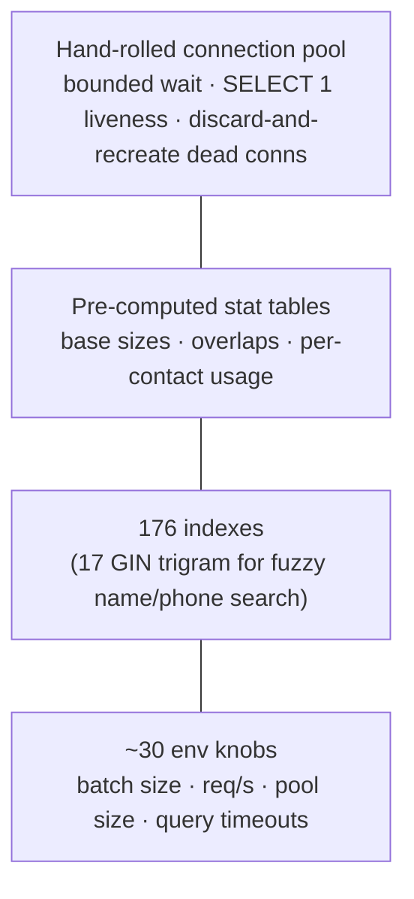

# Architecture

callbase is an ETL pipeline with a UI on top: **import → dedupe → enrich →
filter/segment → export**, built for volume. The interesting engineering is all in
the data layer. These diagrams render on GitHub; the product source is private.

## The pipeline

```mermaid
flowchart LR
    CSV["CSV upload<br/>(hundreds of thousands of rows)"] --> OBJ[("Object storage")]
    OBJ --> ING["Import worker"]

    subgraph ingest["Import — built for volume"]
        NORM["Phone normalization<br/>(formats, Excel mangling, prefixes)"]
        DEDUP1["In-file dedup<br/>(in-memory set)"]
        DEDUP2["Global dedup<br/>INSERT … ON CONFLICT DO NOTHING RETURNING"]
        BATCH["Batched writes<br/>1,000 rows / bulk insert"]
    end
    ING --> NORM --> DEDUP1 --> DEDUP2 --> BATCH --> PG[("PostgreSQL")]

    PG --> ENR["Enrichment worker"]
    subgraph enrich["Enrich — polite to the API, fast for us"]
        RL["Rate limiter<br/>(token spacing, monotonic clock)"]
        KS["Keyset pagination<br/>WHERE id > cursor (partial index)"]
        LOCK["Advisory lock + FOR UPDATE SKIP LOCKED<br/>+ heartbeat re-queue"]
        RETRY["Backoff retries on 429 / 5xx"]
    end
    ENR --> RL --> KS --> LOCK --> RETRY --> EXT["External region/carrier API"]

    PG --> SEG["Filter / segment"]
    SEG --> EXP["Streamed CSV export<br/>(Excel-friendly, 2 modes)"]
```

## Why each piece exists

- **Batched writes, not row-by-row.** Three tables written per flush (raw rows,
  canonical contacts, the contact↔source link) in one bulk insert per table per
  batch. `ANALYZE` after a big import so the planner doesn't go stale.
- **Two-level dedup, one scan.** In-file duplicates via an in-memory set; global
  duplicates via `INSERT … ON CONFLICT (phone) DO NOTHING RETURNING` — the rows
  that come back *are* the genuinely new ones, so the global-dup count falls out of
  the difference with no second scan.
- **Keyset (cursor) pagination over un-enriched rows**, backed by a partial index —
  never a slow `OFFSET`, never re-scanning finished work.
- **Concurrency done right.** A Postgres advisory lock guarantees one enrichment
  job at a time; `FOR UPDATE SKIP LOCKED` hands out work cleanly; a heartbeat
  detects a dead job and re-queues it.

## The data layer at a glance

- **No ORM, on purpose** — Python + FastAPI + raw SQL (psycopg2), because the whole
  point is tight control over how queries run at scale.
- **72 SQL migrations · ~62 tables · 176 indexes.** Much of the commit history is
  sustained performance hardening, which is what building for scale actually looks
  like.

---

## What's public here / what stays private

This is a **case-study repository.** The production source is private (it's a real
system with a client's data). What's public is the architecture and the reasoning;
what stays private is the application code, the credentials, and the data itself.
